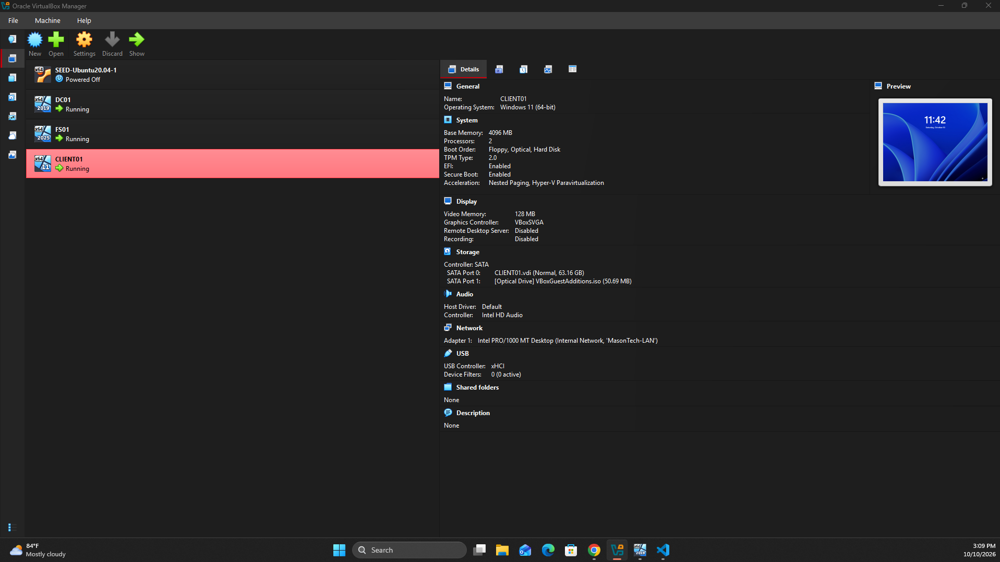
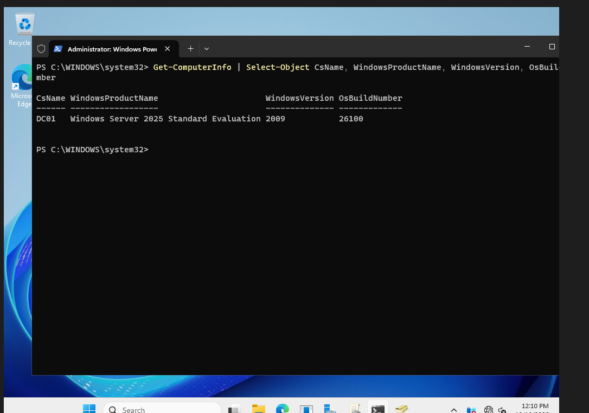
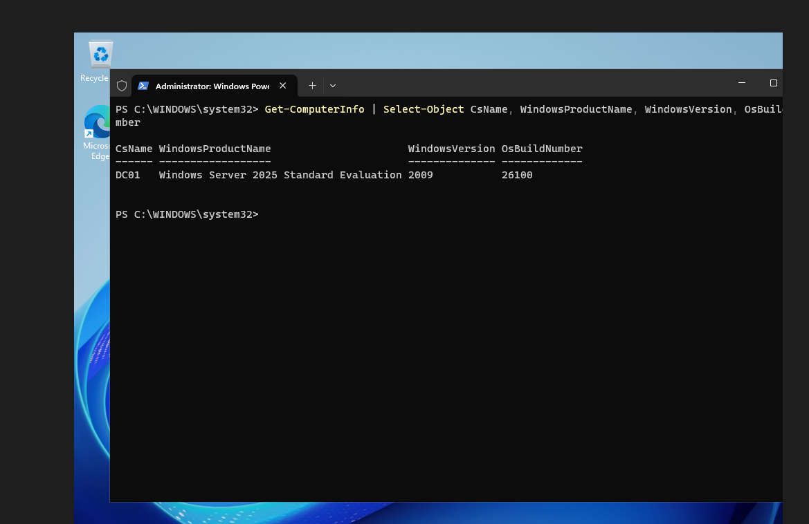
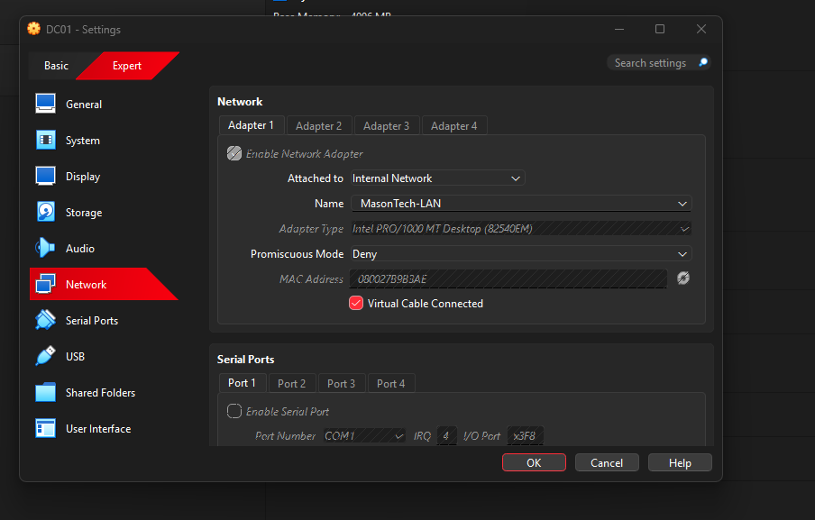
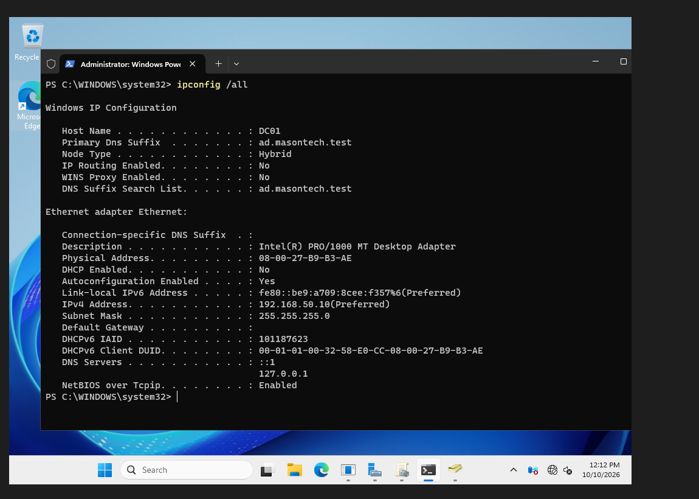
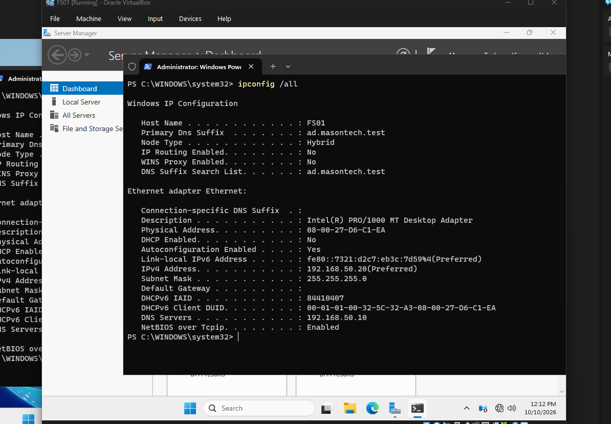

# Phase 1 — Windows Server VM Deployment

## Objective

Deploy and configure Windows Server virtual machines using Oracle VirtualBox as the foundation for Mason Technologies' Active Directory infrastructure.

Establish an isolated virtual network that supports communication between the domain controller, file server, and Windows 11 workstation.

## Business Problem

Mason Technologies is a fictional company with approximately 50 employees requiring centralized identity management, authentication, network services, and secure administration.

To support these requirements, the organization needs reliable server infrastructure capable of hosting Active Directory Domain Services, DNS, DHCP, and centralized file storage.

Oracle VirtualBox was selected to simulate an enterprise Windows Server environment without requiring dedicated physical servers.

## Environment

| Component | Configuration |
|---|---|
| Hypervisor | Oracle VirtualBox |
| DC01 Operating System | Windows Server — version to verify |
| FS01 Operating System | Windows Server 2025 Standard Evaluation (Desktop Experience) |
| Host Machine | [Add host specifications] |
| Domain Controller | DC01 |
| File Server | FS01 |
| Client Workstation | CLIENT01 — Windows 11 Pro |
| DC01 RAM | 4 GB |
| DC01 Virtual CPUs | 2 |
| DC01 Virtual Disk | 60 GB |
| Network Type | Internal Network |
| Network Name | MasonTech-LAN |
| Network Adapter | Intel PRO/1000 MT Desktop (82540EM) |

### Virtual Machine Overview

The completed Phase 1 environment consists of three virtual machines:

- **DC01:** Active Directory Domain Services, DNS, DHCP, and Group Policy
- **FS01:** Departmental file server using SMB and NTFS permissions
- **CLIENT01:** Windows 11 Pro domain-joined workstation

All three virtual machines communicate through the isolated `MasonTech-LAN` network.



## Implementation

### 1. Virtual Machine Deployment

1. Created a new virtual machine named DC01 in Oracle VirtualBox.
2. Allocated 4 GB of RAM, 2 virtual CPUs, and a 60 GB virtual disk.
3. Mounted the Windows Server Evaluation installation ISO.
4. Installed Windows Server with Desktop Experience.
5. Renamed the server to `DC01` and restarted it.

**DC01 Operating System Verification**

Executed the following PowerShell command to verify the server hostname and operating system:

```powershell
Get-ComputerInfo |
    Select-Object CsName, WindowsProductName, WindowsVersion, OsBuildNumber
```



### 2. Additional Server Deployment — FS01

Deployed a second Windows Server virtual machine to provide centralized departmental file storage.

**FS01 Virtual Machine Configuration:**

| Resource | Configuration |
|---|---|
| VM Name | FS01 |
| Operating System | Windows Server 2025 Standard Evaluation |
| Installation Type | Desktop Experience |
| Memory | 4 GB |
| Virtual CPUs | 2 |
| Virtual Disk | 60 GB |
| Network Adapter | Internal Network |
| Internal Network Name | MasonTech-LAN |

FS01 was installed with Windows Server 2025 Standard Evaluation (Desktop Experience) and configured as a separate member server for departmental file sharing.

**FS01 Operating System Verification**

The following command can be used on FS01 to confirm its hostname and operating system:

```powershell
Get-ComputerInfo |
    Select-Object CsName, WindowsProductName, WindowsVersion, OsBuildNumber
```



### 3. Configure the VirtualBox Internal Network

Configured the virtual machines to use the same VirtualBox internal network:

| Setting | Value |
|---|---|
| Attached to | Internal Network |
| Name | MasonTech-LAN |
| Subnet | 192.168.50.0/24 |
| Default Gateway | Not configured |

This isolated lab network allows DC01, FS01, and CLIENT01 to communicate with one another without requiring a connection to an external network. An internal network does not itself provide routing or DHCP; those services must be supplied separately if needed.



### 4. Configure DC01 Network Settings

Assigned DC01 a static IP address so clients and member servers could reliably reach the domain controller and DNS service.

| Setting | Value |
|---|---|
| Hostname | DC01 |
| IPv4 Address | 192.168.50.10 |
| Subnet Mask | 255.255.255.0 |
| DNS Server | 192.168.50.10 |
| Default Gateway | Not configured |

To inspect the active network configuration, executed:

```powershell
ipconfig /all
```



### 5. Configure FS01 Network Settings

Assigned FS01 a static address outside the workstation DHCP pool and configured its DNS client to use DC01.

| Setting | Value |
|---|---|
| Hostname | FS01 |
| IPv4 Address | 192.168.50.20 |
| Subnet Mask | 255.255.255.0 |
| DNS Server | 192.168.50.10 |
| Default Gateway | Not configured |

The DNS server configuration was set using PowerShell:

```powershell
Set-DnsClientServerAddress `
    -InterfaceAlias "Ethernet" `
    -ServerAddresses 192.168.50.10
```

Verified the resulting configuration:

```powershell
ipconfig /all
```



### 6. Validate Server Connectivity

After configuring the network, tested FS01 connectivity to DC01:

```powershell
ping 192.168.50.10
Resolve-DnsName ad.masontech.test
```

Initial name-resolution issues on FS01 were resolved by pointing its DNS client to DC01 (`192.168.50.10`). FS01 was subsequently joined to `ad.masontech.test`, as documented in `05-file-server.md`.

CLIENT01 was later connected to the same internal network and received an IP address from DC01's DHCP scope (`192.168.50.100`–`192.168.50.150`). Client deployment and verification are documented in `06-client-workstation.md`.

## Verification Checklist

- [x] DC01 virtual machine deployed.
- [x] FS01 virtual machine deployed.
- [x] CLIENT01 connected to the same internal network.
- [x] VirtualBox internal network `MasonTech-LAN` configured.
- [x] DC01 static IP address configured as `192.168.50.10`.
- [x] FS01 static IP address configured as `192.168.50.20`.
- [x] FS01 configured to use DC01 for DNS.
- [x] FS01-to-DC01 connectivity and internal DNS resolution verified.
- [ ] Confirm DC01's exact Windows Server edition and version in the environment table.
- [ ] Add physical host specifications.

## Technical Decisions

### Why VirtualBox?

VirtualBox provides an isolated environment for deploying and testing multiple Windows systems on one physical host without dedicated enterprise hardware.

### Why Use an Internal Network?

The internal network keeps the lab systems on the same private segment and avoids exposing the environment directly to external networks. Because no router is configured, no default gateway is required for communication within the subnet.

### Why Use Static Addresses for Servers?

DC01 and FS01 provide infrastructure services that other systems must locate consistently. Static addressing prevents their addresses from changing when workstation DHCP leases are renewed.

## Lessons Learned

- Virtual machines can simulate a small organization's server and workstation infrastructure.
- Consistent network settings are required for domain services to work reliably.
- Static server addressing and DHCP-based workstation addressing serve different purposes.
- Active Directory depends on correct internal DNS configuration.
- Successful IP connectivity does not guarantee that DNS is configured correctly.

## Next Steps

1. Complete the Active Directory domain controller documentation in `02-active-directory.md`.
2. Document Group Policy configuration in `03-group-policy.md`.
3. Document DHCP deployment in `04-dhcp.md`.
4. Document departmental file shares in `05-file-server.md`.
5. Document Windows 11 client integration in `06-client-workstation.md`.
6. Confirm remaining system details and review all screenshots before publishing the Phase 1 portfolio.
