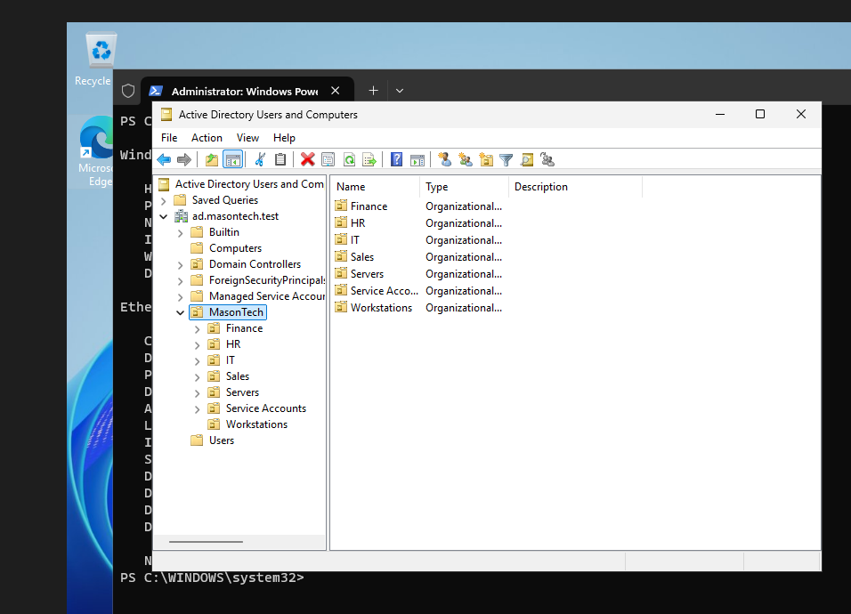
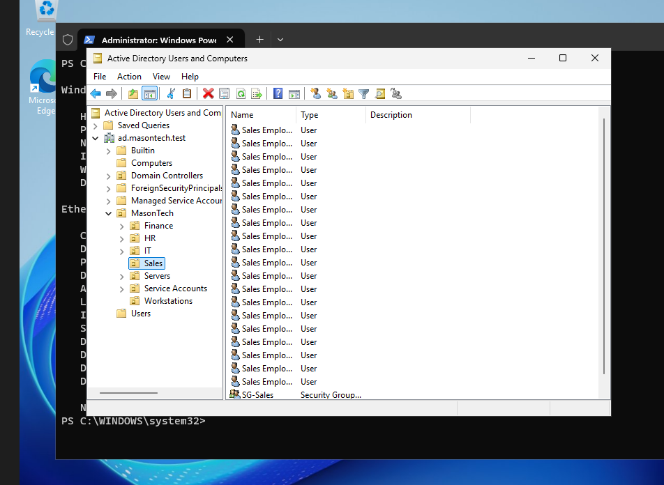
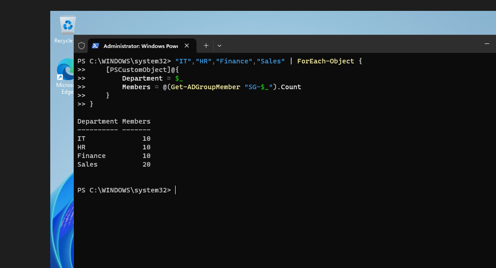

# Phase 1 — Active Directory Domain Controller Deployment

## Objective

Install Active Directory Domain Services (AD DS), promote DC01 to the first domain controller for Mason Technologies, and establish a centralized identity management structure for approximately 50 employees.

## Business Problem

Mason Technologies requires centralized authentication and identity management for approximately 50 employees.

Without a centralized directory service, employee accounts, authentication, and access permissions would need to be managed separately across individual computers and servers.

Active Directory provides a centralized platform for managing users, computers, groups, and security policies.

The company also requires an organized departmental structure and an efficient method for provisioning employee accounts.

## Environment

| Component | Configuration |
|---|---|
| Operating System | Windows Server 2025 Standard Evaluation (verify on DC01) |
| Server Hostname | DC01 |
| IP Address | 192.168.50.10 |
| AD Domain | ad.masontech.test |
| NetBIOS Domain | MASONTECH |
| Forest Type | New forest |
| Forest Functional Level | Windows Server 2025 (verify) |
| Domain Functional Level | Windows Server 2025 (verify) |
| Server Roles | AD DS and DNS Server |
| Global Catalog | Enabled |
| Network | MasonTech-LAN |
| Administration Tools | ADUC, PowerShell, Active Directory Module |

## Implementation

### 1. Install Active Directory Domain Services

1. Opened Server Manager.
2. Navigated to Manage → Add Roles and Features.
3. Selected Role-based or feature-based installation.
4. Selected DC01 as the destination server.
5. Selected Active Directory Domain Services.
6. Accepted the required management features.
7. Completed the role installation.

### 2. Promote DC01 to a Domain Controller

1. Selected "Promote this server to a domain controller" in Server Manager.
2. Selected "Add a new forest."
3. Configured the root domain name as `ad.masontech.test`.
4. Selected Windows Server 2025 forest and domain functional levels.
5. Enabled the DNS Server and Global Catalog options.
6. Created a Directory Services Restore Mode (DSRM) password.
7. Left DNS delegation disabled because the lab has no existing parent DNS infrastructure.
8. Configured the NetBIOS domain name as `MASONTECH`.
9. Accepted the default AD DS database, log, and SYSVOL locations.
10. Completed the prerequisite checks and installed the domain controller configuration.
11. Allowed Windows Server to restart.

### 3. Active Directory Database Locations

| Component | Location |
|---|---|
| AD DS Database | `C:\Windows\NTDS` |
| AD DS Logs | `C:\Windows\NTDS` |
| SYSVOL | `C:\Windows\SYSVOL` |

### 4. Create Organizational Units (OUs)

Created a parent Organizational Unit named `MasonTech` to organize the company's Active Directory objects.

Created seven child OUs to separate departmental users and infrastructure resources.

**Organizational Structure:**

```text
ad.masontech.test
└── MasonTech
    ├── IT
    ├── HR
    ├── Finance
    ├── Sales
    ├── Workstations
    ├── Servers
    └── Service Accounts
```

**Screenshot — Organizational Unit Structure**



**Business Purpose:**

Organizational Units provide a logical structure for managing directory objects and targeting Group Policy settings.

Separating users and computers by department and purpose simplifies administration and supports future access management requirements.

### 5. Automate Employee Account Provisioning

Developed and executed a PowerShell provisioning script using the Active Directory module.

The goal was to provision 50 fictional employee accounts across four departments.

| Department | Target Employees | Security Group |
|---|---:|---|
| IT | 10 | SG-IT |
| HR | 10 | SG-HR |
| Finance | 10 | SG-Finance |
| Sales | 20 | SG-Sales |
| **Total** | **50** | **4 groups** |

The automation workflow was designed to:

1. Import the Active Directory PowerShell module.
2. Identify the appropriate departmental OU.
3. Check whether each departmental security group exists.
4. Create missing security groups.
5. Check whether employee accounts already exist.
6. Create missing employee accounts using a consistent naming convention.
7. Assign employee accounts to their departmental security groups.
8. Require newly created users to change their passwords at first login.

**Naming Convention:**

Employee usernames follow a department-based format.

Examples:

- `it01`
- `hr01`
- `finance01`
- `sales01`

This provides consistent account naming and simplifies automated provisioning.

**Screenshot — Departmental User Accounts**



### 6. Configure Departmental Security Groups

Used Active Directory security groups to organize employee access by department.

| Security Group | Department | Intended Use |
|---|---|---|
| SG-IT | IT | IT resource permissions |
| SG-HR | HR | Human Resources resources |
| SG-Finance | Finance | Financial resources |
| SG-Sales | Sales | Sales resources |

The groups use Global scope and Security category.

**Business Purpose:**

Assigning permissions through security groups is more scalable than managing access separately for individual users.

These groups are used when configuring shared folders and NTFS permissions on FS01.

**Screenshot — Departmental Security Groups**



## Verification

### Active Directory Users and Computers

Opened Server Manager → Tools → Active Directory Users and Computers.

Confirmed that:

- The `ad.masontech.test` domain was available.
- Standard Active Directory containers were present.
- DC01 appeared in the Domain Controllers organizational unit.
- The MasonTech parent OU was created.
- The seven departmental and infrastructure OUs were created.

### PowerShell Domain Verification

Executed:

```powershell
Get-ADDomain
```

Used to verify domain configuration.

Executed:

```powershell
Get-ADDomainController
```

Used to verify that DC01 was registered as a domain controller.

### DNS Verification

Executed:

```powershell
Resolve-DnsName ad.masontech.test
```

Used to verify DNS resolution for the Active Directory domain.

### Organizational Unit Verification

Executed:

```powershell
Get-ADOrganizationalUnit -Filter * |
    Select-Object Name, DistinguishedName
```

Used to inspect Organizational Unit names and distinguished names.

This command also helped identify naming inconsistencies during troubleshooting.

### Employee Account Verification

Used the following command to count users within the MasonTech OU:

```powershell
(Get-ADUser -Filter * -SearchBase "OU=MasonTech,DC=ad,DC=masontech,DC=test").Count
```

**Expected result:** 50 employee accounts.

The final count should be recorded after confirming the actual PowerShell output.

### Security Group Verification

Used the following PowerShell command to verify departmental group memberships:

```powershell
"IT","HR","Finance","Sales" | ForEach-Object {
    [PSCustomObject]@{
        Department = $_
        Members = @(Get-ADGroupMember -Identity "SG-$_").Count
    }
}
```

**Expected results:**

| Department | Expected Members |
|---|---:|
| IT | 10 |
| HR | 10 |
| Finance | 10 |
| Sales | 20 |

These are the intended membership counts. Final verification should reflect the actual command output.

## Verification Checklist

- [x] AD DS role installed.
- [x] New Active Directory forest created.
- [x] Domain `ad.masontech.test` created.
- [x] DC01 promoted to domain controller.
- [x] DNS Server role configured.
- [x] DC01 visible in Active Directory Users and Computers.
- [x] Domain information verified using PowerShell.
- [x] DNS name resolution verified.
- [x] MasonTech parent OU created.
- [x] Seven child OUs created.
- [x] Finance and Sales OU naming errors corrected.
- [x] PowerShell provisioning script developed.
- [ ] Final count of 50 employee accounts verified.
- [ ] All four departmental security groups verified.
- [ ] Departmental group membership counts verified.

## Troubleshooting

### Issue 1 — Organizational Unit Naming Inconsistencies

**Problem:** Some departmental Organizational Units were initially created with incorrect names.

**Cause:** Naming inconsistencies during the initial Active Directory configuration.

**Resolution:** Corrected the Finance and Sales OU names and verified the resulting structure in Active Directory Users and Computers.

**Result:** The intended departmental OU structure was established.

## Lessons Learned

- Active Directory Domain Services centralizes user and computer management.
- Organizational Units help structure directory objects and target Group Policy settings.
- Security groups simplify resource authorization and reduce the need for individual permission assignments.
- PowerShell can automate repetitive identity provisioning tasks.
- Consistent naming conventions improve administrative efficiency.
- DNS is essential for domain controller discovery and domain authentication.
- Verification is necessary to ensure that provisioning scripts produce the expected users and group memberships.

## Next Steps

1. Configure Group Policy security settings for domain users and workstations.
2. Verify departmental group membership and access requirements.
3. Configure DHCP to provide automatic workstation IP addresses.
4. Apply security group permissions to shared folders on FS01.
5. Test domain authentication and resource access using CLIENT01.
