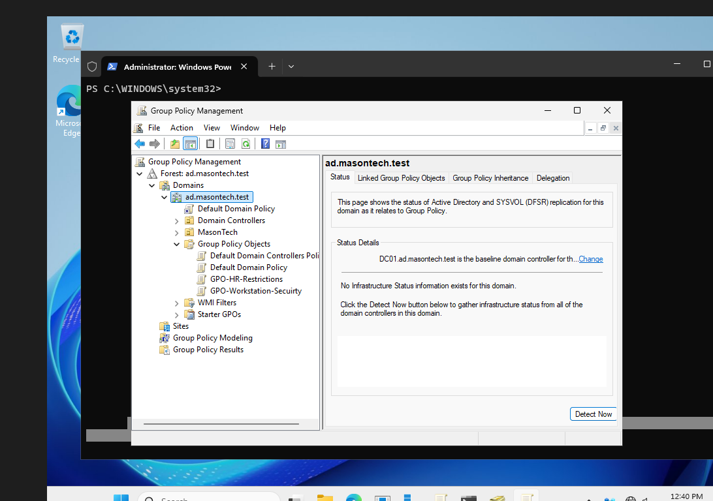
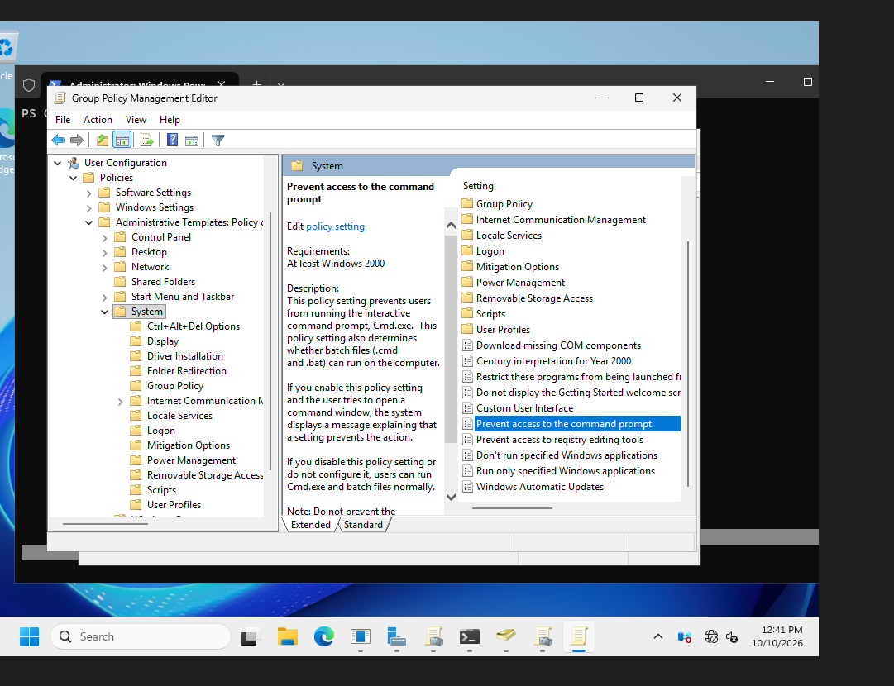

# Phase 1 — Group Policy Configuration

## Objective

Implement centralized security policies for Mason Technologies using Active Directory Group Policy.

## Business Problem

Mason Technologies needs consistent security configurations across employee accounts and workstations.

Manually configuring individual computers is inefficient and increases the risk of inconsistent security settings.

Group Policy allows administrators to centrally manage security settings and apply department-specific restrictions.

## Environment

| Component | Configuration |
|---|---|
| Domain Controller | DC01 |
| Operating System | Windows Server (version to verify) |
| Domain | ad.masontech.test |
| Management Tool | Group Policy Management Console (GPMC) |
| Parent OU | MasonTech |
| Client Workstation | CLIENT01 — Windows 11 Pro |

## Implementation

### 1. Domain Password and Account Lockout Policy

Edited the Default Domain Policy to configure domain-wide password and account lockout requirements.

**Password Policy**

| Setting | Value |
|---|---|
| Enforce password history | 12 passwords |
| Maximum password age | 90 days |
| Minimum password length | 12 characters |
| Password complexity | Enabled |
| Reversible password encryption | Disabled |

**Account Lockout Policy**

| Setting | Value |
|---|---|
| Account lockout threshold | 5 invalid attempts |
| Account lockout duration | 15 minutes |
| Reset lockout counter after | 15 minutes |

**Business Purpose:** Establish consistent authentication requirements and reduce the risk of repeated password-guessing attempts.

These values are lab configurations, not universal production recommendations.

### 2. Workstation Security GPO

**GPO Name:** `GPO-Workstation-Security`

**Linked OU:** `MasonTech/Workstations`

Configured:

`Computer Configuration → Policies → Windows Settings → Security Settings → Local Policies → Security Options`

**Setting:** Interactive logon: Machine inactivity limit

**Value:** 900 seconds (15 minutes)

**Business Purpose:** Automatically lock inactive workstations to reduce unauthorized access to unattended employee sessions.

### 3. HR Restrictions GPO

**GPO Name:** `GPO-HR-Restrictions`

**Linked OU:** `MasonTech/HR`

Configured:

`User Configuration → Policies → Administrative Templates → System`

**Setting:** Prevent access to the command prompt

**Value:** Enabled

**Business Purpose:** Demonstrate department-specific security restrictions and centralized user configuration management.

This restriction does not prevent every method of command or script execution.

## Screenshot Evidence

### Group Policy Objects

The Group Policy Management Console shows the domain's configured GPOs, including the workstation security and HR restriction policies.



### HR Command Prompt Restriction

The following screenshot demonstrates the configured restriction for HR user accounts.



## Verification

### Verify GPO Creation

Executed on DC01:

```powershell
Get-GPO -All | Select-Object DisplayName, GpoStatus
```

Verified the following GPOs:

- Default Domain Policy
- GPO-Workstation-Security
- GPO-HR-Restrictions

### Verify Domain Password Policy

Executed:

```powershell
Get-ADDefaultDomainPasswordPolicy |
    Select-Object MinPasswordLength, MaxPasswordAge, LockoutThreshold
```

Used to verify the domain password and account lockout configuration.

### Client-Side Group Policy Verification

After deploying and joining CLIENT01 to `ad.masontech.test`, signed in using the HR domain account `MASONTECH\hr01`.

Executed:

```powershell
gpupdate /force
gpresult /r
```

Confirmed that the applicable domain policies were processed by CLIENT01.

The HR command prompt restriction was successfully tested using the HR account.

The workstation security GPO was applied to the domain-joined workstation. The configured inactivity limit is 900 seconds.

The `gpresult /r` output is documented in `06-client-workstation.md`.

## Verification Checklist

- [x] Domain password policy configured.
- [x] Account lockout policy configured.
- [x] Workstation Security GPO created and linked.
- [x] HR Restrictions GPO created and linked.
- [x] GPO configuration verified with PowerShell.
- [x] Workstation Security GPO applied to CLIENT01.
- [x] HR Restrictions GPO applied to the HR domain account.
- [x] Client-side Group Policy processing verified.

## Technical Decisions

### Why Use Group Policy?

Group Policy enables centralized management of security configurations across domain-joined Windows computers and user accounts.

### Why Separate GPOs?

Separating policies makes it easier to manage settings, troubleshoot issues, and target specific organizational units.

### Why Link Workstation Security to the Workstations OU?

The policy should apply to employee workstations rather than infrastructure servers.

### Why Link HR Restrictions to the HR OU?

Linking the policy to the HR OU targets HR user accounts without applying the restriction to other departments.

## Lessons Learned

- Group Policy centralizes Windows configuration management.
- GPOs can target users or computers depending on their configuration and link location.
- Organizational Units help control policy scope.
- Password and account lockout policies support centralized domain authentication security.
- GPO creation and client-side application require separate verification.
- `gpupdate` initiates policy refresh, while `gpresult` helps identify which policies were applied.
- Testing with a domain user account is important when verifying user-targeted GPOs.

## Next Steps

1. Document DHCP configuration and client IP address assignment.
2. Document departmental file shares and security group permissions on FS01.
3. Document CLIENT01 domain membership and final Group Policy verification.
4. Complete Phase 1 documentation and prepare the environment for Phase 2 — Azure and Hybrid Identity.
