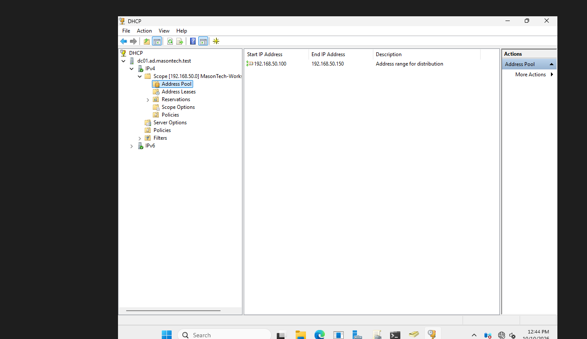
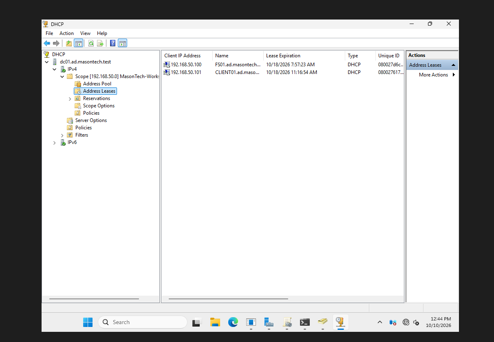

# Phase 1 — DHCP Server Deployment and Configuration

## Objective

Install, configure, and validate Dynamic Host Configuration Protocol (DHCP) services on DC01 to automatically assign IP addresses and network configuration settings to workstations within the Mason Technologies domain.

## Business Problem

Mason Technologies requires reliable network connectivity for approximately 50 employees.

Without DHCP, administrators would need to manually configure IP addresses, subnet masks, DNS servers, and other network settings on individual workstations.

Manual configuration increases administrative overhead and creates opportunities for IP address conflicts and configuration errors.

Deploying DHCP allows employee workstations to automatically receive consistent network settings from a centrally managed Windows Server.

## Environment

| Component | Configuration |
|---|---|
| DHCP Server | DC01 |
| Active Directory Domain | ad.masontech.test |
| DHCP Server IP | 192.168.50.10 |
| DNS Server | 192.168.50.10 |
| Network | MasonTech-LAN |
| Network Address | 192.168.50.0/24 |
| Subnet Mask | 255.255.255.0 |
| DHCP Scope Name | MasonTech-Workstations |
| DHCP Address Range | 192.168.50.100–192.168.50.150 |
| Available Addresses | 51 |
| Default Gateway | Not configured |
| Client Workstation | CLIENT01 |
| Client Operating System | Windows 11 Pro |
| Virtualization Platform | Oracle VirtualBox |

## Implementation

### 1. Install DHCP Server Role

Opened PowerShell as Administrator on DC01 and installed the DHCP Server role.

```powershell
Install-WindowsFeature DHCP -IncludeManagementTools
```

**Explanation:**

- `Install-WindowsFeature` installs Windows Server roles and features.
- `DHCP` specifies the DHCP Server role.
- `-IncludeManagementTools` installs the graphical DHCP management tools.

This enabled DC01 to function as a DHCP server.

### 2. Authorize DHCP in Active Directory

Authorized DC01 to provide DHCP services within the Active Directory domain.

```powershell
Add-DhcpServerInDC -DnsName "DC01.ad.masontech.test" -IPAddress 192.168.50.10
```

Active Directory authorization allows Windows DHCP servers to verify that they are permitted to provide DHCP services in an AD-managed environment.

This helps reduce the risk of unauthorized Windows DHCP servers distributing incorrect network configurations.

### 3. Create the DHCP Scope

Created an IPv4 scope for employee workstations.

```powershell
Add-DhcpServerv4Scope `
    -Name "MasonTech-Workstations" `
    -StartRange 192.168.50.100 `
    -EndRange 192.168.50.150 `
    -SubnetMask 255.255.255.0 `
    -State Active
```

**Scope Configuration:**

| Setting | Value |
|---|---|
| Scope Name | MasonTech-Workstations |
| Network | 192.168.50.0/24 |
| Starting Address | 192.168.50.100 |
| Ending Address | 192.168.50.150 |
| Subnet Mask | 255.255.255.0 |
| Scope State | Active |

The DHCP scope contains 51 assignable IPv4 addresses.

The DHCP address pool excludes the static addresses used by infrastructure servers:

- DC01: `192.168.50.10`
- FS01: `192.168.50.20`

This separates infrastructure addressing from dynamically assigned workstation addresses.

**Screenshot — DHCP Scope Address Pool**



### 4. Configure DHCP Scope Options

Configured the DHCP scope to distribute the internal DNS server address and domain suffix.

```powershell
Set-DhcpServerv4OptionValue `
    -ScopeId 192.168.50.0 `
    -DnsServer 192.168.50.10 `
    -DnsDomain "ad.masontech.test"
```

**Configured Options:**

| DHCP Option | Value |
|---|---|
| DNS Server (006) | 192.168.50.10 |
| DNS Domain Name (015) | ad.masontech.test |
| Router / Default Gateway (003) | Not configured |

**Business Purpose:**

Client workstations use DC01 for DNS resolution, allowing them to locate Active Directory services and internal servers.

No default gateway was configured because MasonTech-LAN is an isolated VirtualBox internal network without a router.

### 5. Verify DHCP Server Configuration

Executed the following PowerShell commands on DC01.

**Verify Active Directory authorization:**

```powershell
Get-DhcpServerInDC
```

**Verify DHCP scope:**

```powershell
Get-DhcpServerv4Scope
```

**Verify DHCP scope options:**

```powershell
Get-DhcpServerv4OptionValue -ScopeId 192.168.50.0
```

**Verify DHCP service status:**

```powershell
Get-Service DHCPServer
```

These commands were used to inspect server authorization, scope configuration, DNS options, and DHCP service status.

### 6. Test DHCP Using CLIENT01

Deployed a Windows 11 Pro workstation named CLIENT01 on the same VirtualBox internal network as DC01.

Configured CLIENT01 to obtain its IP address automatically.

Executed:

```powershell
ipconfig /all
```

Verified that CLIENT01 received an IPv4 address within the configured DHCP scope and used DC01 for DHCP and DNS.

**Expected Configuration:**

| Setting | Result |
|---|---|
| DHCP Enabled | Yes |
| IPv4 Address | Within 192.168.50.100–150 |
| Subnet Mask | 255.255.255.0 |
| DHCP Server | 192.168.50.10 |
| DNS Server | 192.168.50.10 |
| DNS Suffix | ad.masontech.test |

The exact leased workstation IP address can be obtained from CLIENT01 or the DHCP management console.

**Screenshot — CLIENT01 DHCP Lease**

The DHCP Address Leases view provides evidence that the DHCP server assigned a workstation address from the configured scope.



### 7. Verify Network Connectivity and DNS

From CLIENT01, tested connectivity to the domain controller and file server.

```powershell
ping 192.168.50.10
ping 192.168.50.20
```

Verified DNS resolution:

```powershell
Resolve-DnsName ad.masontech.test
Resolve-DnsName FS01.ad.masontech.test
```

Tested connectivity to the domain controller's LDAP service:

```powershell
Test-NetConnection DC01.ad.masontech.test -Port 389
```

These tests confirmed that CLIENT01 could communicate with the internal infrastructure and resolve domain-related hostnames.

## Verification Results

End-to-end validation was performed using CLIENT01 after the DHCP deployment.

| Test | Result |
|---|---|
| DHCP address assignment | Passed |
| DHCP address within configured scope | Passed |
| DNS server configuration | Passed |
| DC01 network connectivity | Passed |
| FS01 network connectivity | Passed |
| Active Directory DNS resolution | Passed |
| Domain controller connectivity | Passed |
| CLIENT01 domain join | Passed |

The successful CLIENT01 domain join also demonstrated that the workstation could communicate with Active Directory using the configured network services.

## Verification Checklist

- [x] DHCP Server role installed on DC01.
- [x] DHCP server authorized in Active Directory.
- [x] MasonTech-Workstations scope created.
- [x] DHCP scope activated.
- [x] DNS server and domain suffix options configured.
- [x] Static infrastructure IP addresses excluded from the DHCP pool.
- [x] CLIENT01 received an IP address automatically.
- [x] CLIENT01 successfully resolved internal DNS names.
- [x] CLIENT01 communicated with DC01 and FS01.
- [x] CLIENT01 successfully joined the Active Directory domain.

## Technical Decisions

### Why Use DHCP?

DHCP automates IP address assignment and reduces the need for manual workstation configuration.

### Why Host DHCP on DC01?

DC01 already provides centralized infrastructure services for the small Mason Technologies lab.

Combining AD DS, DNS, and DHCP on DC01 reduces the number of virtual machines required for this learning environment.

In larger production environments, DHCP services may be separated or deployed redundantly to improve availability.

### Why Use the 192.168.50.100–150 Range?

This range provides enough addresses for approximately 50 employee workstations while keeping infrastructure servers outside the DHCP pool.

### Why Use DC01 as the DNS Server?

Active Directory relies on DNS for locating domain controllers and other domain services.

Providing DC01's DNS address through DHCP ensures workstations use the correct internal DNS infrastructure.

### Why Is There No Default Gateway?

MasonTech-LAN is an isolated VirtualBox internal network without a router.

A default gateway would be required if workstations needed to communicate with networks outside the local subnet.

## Security Considerations

- DHCP was authorized within Active Directory.
- The DHCP scope was limited to the internal lab subnet.
- Infrastructure servers use static IP addresses outside the dynamic allocation range.
- MasonTech-LAN is isolated from external networks.
- DHCP configuration was validated before completing domain integration.

## Technical Concepts Learned

### DHCP Scope

A defined range of IP addresses that a DHCP server can lease to client devices.

### DHCP Lease

A temporary assignment of an IP address and related network settings to a client.

### DORA Process

The four-stage process used for initial DHCP address allocation:

1. Discover — The client searches for DHCP servers.
2. Offer — A DHCP server offers an available address.
3. Request — The client requests the offered address.
4. Acknowledge — The server confirms the lease.

### DHCP Options

Additional configuration information provided to clients, such as DNS server addresses, domain suffixes, and default gateways.

### DHCP and Active Directory

DHCP provides network configuration, while Active Directory manages domain identities and authentication.

DHCP does not authenticate users or automatically join computers to the domain.

## Screenshot Evidence

The screenshots are embedded in the implementation sections above.

- [x] DHCP scope address pool — `01-dhcp-scope.png`
- [x] CLIENT01 DHCP address lease — `02-dhcp-lease.png`

## Lessons Learned

- DHCP automates workstation IP address configuration.
- Windows Server can provide DHCP services through a dedicated server role.
- Active Directory authorization is an important control for Windows DHCP servers.
- DHCP scopes define which IP addresses may be assigned to clients.
- DHCP options provide additional network configuration, including DNS information.
- Infrastructure servers should use predictable IP addresses.
- DNS and DHCP work together to support domain connectivity.
- Successful client-side testing is necessary to validate DHCP deployment.

## Next Steps

1. Document FS01 deployment and departmental file sharing.
2. Document CLIENT01 installation and Active Directory domain integration.
3. Record final end-to-end test results.
4. Update the main project README with the completed Phase 1 architecture.
5. Prepare the environment for Phase 2 — Azure and Hybrid Cloud Infrastructure.
