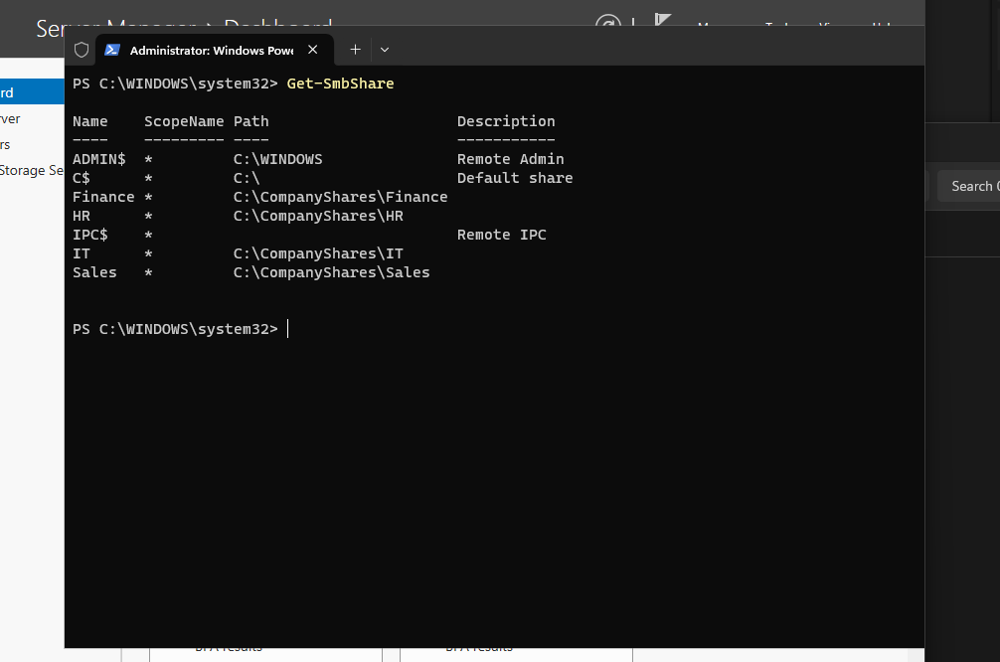
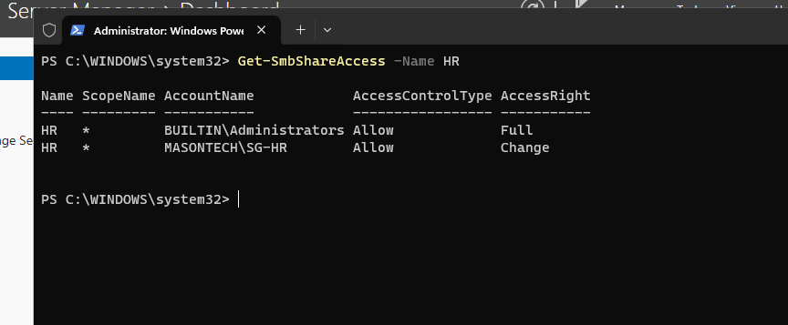
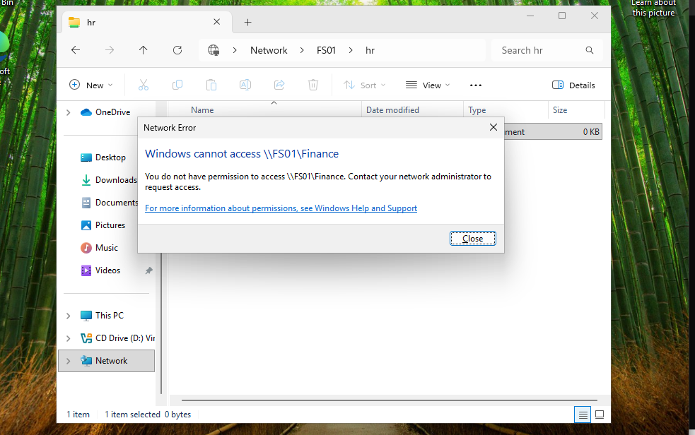

# Phase 1 — File Server Deployment and Departmental Access Control
## Objective
Deploy and configure a Windows Server file server (FS01) to provide centralized departmental file storage for Mason Technologies.

Integrate FS01 with the existing Active Directory domain and implement role-based access control using Active Directory security groups, NTFS permissions, and SMB share permissions.

Validate that employees can access files belonging to their departments while being restricted from accessing unauthorized departmental resources.

## Business Problem
Mason Technologies is a fictional organization with approximately 50 employees across four departments:

- IT

- Human Resources (HR)

- Finance

- Sales

The organization requires a centralized solution for storing and accessing departmental files.

Without a dedicated file server, employees might store business documents locally, resulting in inconsistent access controls, difficulty sharing files, and increased risk of unauthorized access.

A centralized file server allows IT administrators to manage file storage and permissions through Active Directory security groups.

The solution follows the principle of least privilege by granting employees access only to resources required for their job responsibilities.

## Environment
| Component | Configuration |

|---|---|

| File Server | FS01 |

| Operating System | Windows Server 2025 Standard Evaluation (Desktop Experience) |

| Domain Controller | DC01 |

| Active Directory Domain | ad.masontech.test |

| File Server IP | 192.168.50.20 |

| Domain Controller IP | 192.168.50.10 |

| DNS Server | 192.168.50.10 |

| Network | MasonTech-LAN |

| Hypervisor | Oracle VirtualBox |

| File Sharing Protocol | SMB |

| Access Control | NTFS and SMB share permissions |

| Client Workstation | CLIENT01 (Windows 11 Pro) |

## Implementation
### 1. Deploy FS01 Virtual Machine
Created a Windows Server virtual machine in Oracle VirtualBox.

****Virtual Machine Configuration:****

| Resource | Configuration |

|---|---|

| VM Name | FS01 |

| Operating System | Windows Server 2025 |

| Installation Type | Desktop Experience |

| Memory | 4 GB |

| Virtual CPUs | 2 |

| Virtual Disk | 60 GB |

| Network Adapter | Internal Network |

| Internal Network Name | MasonTech-LAN |

The internal network allows FS01 to communicate with DC01 and CLIENT01 without exposing the lab infrastructure directly to external networks.

### 2. Configure Computer Name and Static IP Address
Renamed the server FS01 and configured a static IPv4 address.

****Network Configuration:****

| Setting | Value |

|---|---|

| Hostname | FS01 |

| IPv4 Address | 192.168.50.20 |

| Subnet Mask | 255.255.255.0 |

| DNS Server | 192.168.50.10 |

| Default Gateway | Not configured |

The file server uses a static IP address to ensure predictable connectivity for clients accessing shared folders.

Configured the DNS client to use DC01:

```powershell

Set-DnsClientServerAddress `

    -InterfaceAlias "Ethernet" `

    -ServerAddresses 192.168.50.10

```

****Explanation:****

- `Set-DnsClientServerAddress` configures DNS servers for a network interface.

- `-InterfaceAlias "Ethernet"` selects the network adapter.

- `-ServerAddresses 192.168.50.10` configures DC01 as the DNS server.

Using DC01 for DNS allows FS01 to locate Active Directory services and resolve internal domain names.

### 3. Verify Connectivity to the Domain Controller
Executed connectivity tests from FS01:

```powershell

ping 192.168.50.10

```

Verified internal DNS resolution:

```powershell

Resolve-DnsName ad.masontech.test

```

Both tests succeeded after the DNS client configuration was corrected.

### 4. Join FS01 to Active Directory
Joined FS01 to the Mason Technologies Active Directory domain.

```powershell

Add-Computer `

    -DomainName "ad.masontech.test" `

    -Credential "MASONTECH\Administrator" `

    -Restart

```

****Explanation:****

- `Add-Computer` joins a Windows computer to a domain.

- `-DomainName` specifies the Active Directory domain.

- `-Credential` provides an authorized domain account.

- `-Restart` restarts the computer after joining.

After restarting, FS01 became a domain-joined server capable of using Active Directory identities and security groups.

****Verification:****

```powershell

(Get-CimInstance Win32_ComputerSystem).Domain

```

Expected output:

```text

ad.masontech.test

```

### 5. Install the File Server Role
Installed the Windows Server File Server role using PowerShell.

```powershell

Install-WindowsFeature FS-FileServer -IncludeManagementTools

```

****Explanation:****

- `Install-WindowsFeature` installs Windows Server roles and features.

- `FS-FileServer` installs the File Server role service.

- `-IncludeManagementTools` installs the associated administration tools.

This enabled FS01 to provide shared file storage through Server Message Block (SMB).

### 6. Create Departmental Folders
Created a central directory for company shares:

```text

C:\CompanyShares\\

```

Created four departmental folders:

```text

C:\CompanyShares\\

├── IT\\

├── HR\\

├── Finance\\

└── Sales\\

```

PowerShell:

```powershell

$departments = @("IT", "HR", "Finance", "Sales")

foreach ($department in $departments) {

    New-Item `

        -Path "C:\CompanyShares\\$department" `

        -ItemType Directory `

        -Force

}

```

****Explanation:****

- `$departments` stores the departmental names.

- `foreach` processes each department.

- `New-Item` creates a directory.

- `-Force` allows existing directories to remain without causing an error.

This created a consistent directory structure for departmental file storage.

### 7. Configure NTFS Permissions
Configured NTFS permissions to restrict departmental folder access.

Each departmental folder was assigned permissions for:

- `SYSTEM` — Full Control

- `BUILTIN\Administrators` — Full Control

- Corresponding Active Directory departmental security group — Modify

For example:

| Folder | AD Security Group | Permission |

|---|---|---|

| IT | MASONTECH\SG-IT | Modify |

| HR | MASONTECH\SG-HR | Modify |

| Finance | MASONTECH\SG-Finance | Modify |

| Sales | MASONTECH\SG-Sales | Modify |

Disabled inherited NTFS permissions on the departmental folders and configured explicit access control entries.

****Example: HR folder****

```powershell

$path = "C:\CompanyShares\HR"

$acl = Get-Acl $path

$acl.SetAccessRuleProtection($true, $false)

$acl.Access | ForEach-Object {

    $acl.RemoveAccessRuleSpecific($_)

}

$rules = @(

    [System.Security.AccessControl.FileSystemAccessRule]::new(

        "SYSTEM", "FullControl", "ContainerInherit,ObjectInherit",

        "None", "Allow"

    ),

    [System.Security.AccessControl.FileSystemAccessRule]::new(

        "BUILTIN\Administrators", "FullControl",

        "ContainerInherit,ObjectInherit", "None", "Allow"

    ),

    [System.Security.AccessControl.FileSystemAccessRule]::new(

        "MASONTECH\SG-HR", "Modify",

        "ContainerInherit,ObjectInherit", "None", "Allow"

    )

)

foreach ($rule in $rules) {

    $acl.AddAccessRule($rule)

}

Set-Acl -Path $path -AclObject $acl

```

****Explanation:****

- `Get-Acl` retrieves the folder's access control list.

- `SetAccessRuleProtection($true, $false)` disables permission inheritance without retaining inherited entries.

- `RemoveAccessRuleSpecific()` removes existing access rules from the ACL object.

- `FileSystemAccessRule` defines permissions for specific users or groups.

- `Set-Acl` applies the updated permissions to the folder.

The same permission structure was implemented for the IT, Finance, and Sales folders using their corresponding Active Directory security groups.

****Security Purpose:****

NTFS permissions control access to files and folders on the underlying Windows file system.

Employees receive permissions through their departmental group membership rather than through individually assigned permissions.

This makes the environment easier to maintain as employees join, leave, or change departments.

### 8. Configure SMB File Shares
Created departmental SMB shares so domain users could access their folders over the network.

****Share Configuration:****

| Share | Network Path | Authorized Group |

|---|---|---|

| IT | \\\FS01\IT | SG-IT |

| HR | \\\FS01\HR | SG-HR |

| Finance | \\\FS01\Finance | SG-Finance |

| Sales | \\\FS01\Sales | SG-Sales |

PowerShell:

```powershell

$departments = @("IT", "HR", "Finance", "Sales")

foreach ($department in $departments) {

    New-SmbShare `

        -Name $department `

        -Path "C:\CompanyShares\\$department" `

        -ChangeAccess "MASONTECH\SG-$department" `

        -FullAccess "MASONTECH\Domain Admins"

}

```

****Explanation:****

- `New-SmbShare` creates a Windows network file share.

- `-Name` specifies the share name.

- `-Path` specifies the local directory.

- `-ChangeAccess` grants the departmental security group read/write access through the share.

- `-FullAccess` grants the specified administrative group full share permissions.

The deployed shares also provide administrative access for authorized administrators.

****Important distinction:****

SMB share permissions control access over the network, while NTFS permissions control access to the underlying files and folders.

When accessing files through SMB, both sets of permissions apply. The more restrictive effective permissions determine the user's access.

### 9. Verify File Shares and Permissions
Used PowerShell to inspect the configured shares.

```powershell

Get-SmbShare

```

Reviewed SMB permissions:

```powershell

Get-SmbShareAccess -Name HR

```

Reviewed NTFS permissions:

```powershell

Get-Acl "C:\CompanyShares\HR" |

    Format-List

```

These commands allow administrators to verify that departmental shares exist and have the intended access controls.

**Screenshot — Departmental SMB Shares**



**Screenshot — HR SMB Share Permissions**



## End-to-End Testing
### Test 1 — Domain User Authentication
Signed into CLIENT01 using an Active Directory HR employee account:

```text

MASONTECH\hr01

```

Verified the logged-in identity:

```powershell

whoami

```

Expected output:

```text

masontech\hr01

```

****Result: Passed****

CLIENT01 successfully authenticated the employee through Active Directory.

### Test 2 — Authorized Departmental Access
While signed in as `MASONTECH\hr01`, opened File Explorer and navigated to:

```text

\\\FS01\HR

```

Successfully accessed the HR share and created a test file:

```text

HR-Test.txt

```

****Result: Passed****

This demonstrated that the HR employee account had the necessary permissions to access and modify files in its authorized departmental share.

### Test 3 — Unauthorized Departmental Access
While signed in as the same HR employee, attempted to access:

```text

\\\FS01\Finance

```

Windows denied access.

****Result: Passed****

This demonstrated that an HR employee could not access Finance resources without the required group membership and permissions.

**Screenshot — Unauthorized Finance Access Denied**



### Test 4 — Network and DNS Connectivity
Verified CLIENT01 could communicate with FS01.

```powershell

ping 192.168.50.20

```

Verified internal DNS resolution:

```powershell

Resolve-DnsName FS01.ad.masontech.test

```

****Result: Passed****

CLIENT01 successfully communicated with the file server and resolved its domain hostname.

## Verification Results
| Test | Result |

|---|---|

| FS01 deployed successfully | Passed |

| Static IP configured | Passed |

| DNS resolution to DC01 | Passed |

| Active Directory domain join | Passed |

| File Server role installation | Passed |

| Departmental folders created | Passed |

| Departmental SMB shares configured | Passed |

| NTFS permissions configured | Passed |

| HR employee authentication | Passed |

| HR share access and file creation | Passed |

| Unauthorized Finance access blocked | Passed |

| CLIENT01-to-FS01 connectivity | Passed |

## Technical Decisions
### Why Use a Dedicated File Server?
A dedicated file server centralizes departmental file storage and separates file services from domain controller responsibilities.

This makes the environment more representative of business infrastructure and supports more manageable access control.

### Why Use Active Directory Security Groups?
Assigning permissions to groups rather than individual users simplifies administration.

When an employee joins HR, administrators can add the employee to `SG-HR` instead of configuring permissions on every HR folder.

### Why Configure Both NTFS and Share Permissions?
NTFS permissions provide file-system-level security, while SMB permissions control network access.

Using both provides layered access control for shared resources.

### Why Disable NTFS Inheritance?
Disabling inheritance allows each departmental folder to maintain an explicit permission configuration rather than automatically inheriting access from its parent directory.

### Why Use SMB?
Server Message Block is the standard Windows protocol for accessing shared files and folders across a network.

SMB enables Windows domain users to access centralized resources through UNC paths such as `\\\FS01\HR`.

## Security Considerations
- Departmental access is managed through Active Directory security groups.

- NTFS permissions are explicitly configured on departmental folders.

- SMB share permissions restrict network access.

- Unauthorized cross-department access was successfully denied.

- Administrative access is maintained for system administrators.

- FS01 operates within an isolated internal lab network.

## Technical Concepts Learned
### SMB
Server Message Block is a network protocol used for file and printer sharing.

### NTFS Permissions
Windows file system permissions that control read, write, modify, and administrative access to files and directories.

### Role-Based Access Control (RBAC)
A security model in which permissions are assigned based on job roles or responsibilities.

In this project, Active Directory security groups represent departmental roles.

### Least Privilege
The principle of granting users only the access necessary to perform their responsibilities.

### UNC Path
A Universal Naming Convention path identifies a network resource.

Example:

```text

\\\FS01\HR

```

### Permission Inheritance
A mechanism by which files and folders receive permissions from parent directories.

Disabling inheritance allows administrators to configure explicit permissions.

## Challenges and Troubleshooting
### DNS Configuration Issue
During initial FS01 deployment, the server could communicate with DC01 by IP address but failed to resolve domain names.

****Cause:****

The DNS client configuration was not correctly pointing to the internal domain DNS server.

****Resolution:****

Configured the network interface to use DC01:

```powershell

Set-DnsClientServerAddress `

    -InterfaceAlias "Ethernet" `

    -ServerAddresses 192.168.50.10

```

After correcting the DNS configuration, domain name resolution succeeded and FS01 successfully joined the Active Directory domain.

****Lesson Learned:****

Successful IP connectivity does not necessarily mean DNS is functioning correctly.

Active Directory depends heavily on DNS, making correct DNS configuration essential for domain integration.

## Screenshots
Screenshots will be added during the final documentation and portfolio review.

Planned evidence:

- [ ] FS01 VirtualBox configuration

- [ ] FS01 network configuration

- [ ] FS01 domain membership

- [ ] File Server role installation

- [ ] Departmental folder structure

- [ ] SMB shares and share permissions

- [ ] HR NTFS permissions

- [ ] Successful HR share access from CLIENT01

- [ ] Finance access denied for HR employee

## Lessons Learned
- Windows Server can provide centralized departmental file storage.

- File servers can integrate directly with Active Directory for authentication and authorization.

- Security groups simplify permissions management.

- NTFS and SMB permissions work together to protect network resources.

- Separating file services from domain controller services improves infrastructure organization.

- DNS is essential for reliable Active Directory integration.

- Testing with actual domain user accounts is necessary to validate effective permissions.

- Least-privilege access can be demonstrated by verifying both authorized and unauthorized access.

## Next Steps
1. Document CLIENT01 deployment and domain integration.

2. Document Group Policy and file-access verification from the client perspective.

3. Verify that all Phase 1 screenshots display correctly in Markdown Preview.

4. Update the project README with the completed infrastructure architecture.

5. Create VirtualBox snapshots before starting Phase 2.

6. Begin Phase 2 — Azure and Hybrid Cloud Infrastructure.