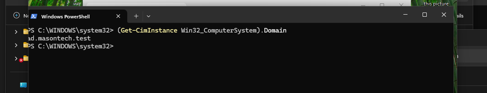
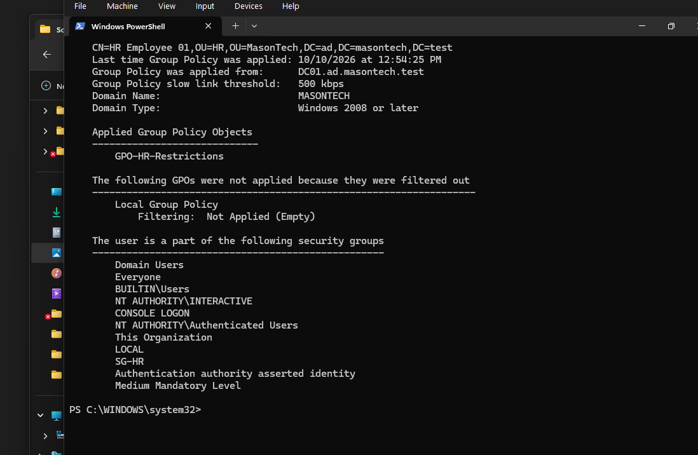

# Phase 1 — Windows 11 Workstation Deployment and Domain Integration
## Objective
Deploy a Windows 11 Pro client workstation and integrate it into the Mason Technologies Active Directory environment.

Validate centralized authentication, automatic network configuration, Group Policy enforcement, DNS resolution, and role-based access to departmental file shares.

This deployment serves as the final end-to-end validation of the Phase 1 Windows Server infrastructure.

## Business Problem
Mason Technologies is a fictional organization supporting approximately 50 employees across IT, HR, Finance, and Sales.

Employees require secure, centrally managed workstations that can access company resources.

Without centralized management, administrators would need to configure individual computers, maintain separate local accounts, and manually enforce security settings.

Integrating Windows 11 workstations with Active Directory enables:

- Centralized employee authentication

- Automatic IP address assignment

- Domain-based DNS resolution

- Group Policy enforcement

- Department-specific access permissions

- Centralized computer account management

## Environment
| Component | Configuration |

|---|---|

| Client Computer | CLIENT01 |

| Operating System | Windows 11 Pro |

| Domain | ad.masontech.test |

| NetBIOS Domain | MASONTECH |

| Domain Controller | DC01 |

| Domain Controller IP | 192.168.50.10 |

| File Server | FS01 |

| File Server IP | 192.168.50.20 |

| DHCP Server | DC01 |

| DNS Server | DC01 |

| Network | MasonTech-LAN |

| IP Configuration | DHCP |

| Virtualization Platform | Oracle VirtualBox |

## Implementation
### 1. Deploy Windows 11 Virtual Machine
Created a Windows 11 virtual machine using Oracle VirtualBox.

**Virtual Machine Configuration**
| Resource | Configuration |

|---|---|

| Virtual Machine Name | CLIENT01 |

| Operating System | Windows 11 Pro |

| Memory | 4 GB |

| Virtual CPUs | 2 |

| Virtual Disk | 64 GB |

| Network Adapter | Internal Network |

| Network Name | MasonTech-LAN |

The virtual machine was connected to the same isolated internal network as DC01 and FS01.

This allowed the client workstation to communicate with the domain infrastructure without requiring external network connectivity.

### 2. Complete Windows 11 Installation
Booted CLIENT01 using a Windows 11 installation ISO.

Selected Windows 11 Pro because it supports joining an Active Directory domain.

During the Windows Out-of-Box Experience (OOBE), Windows requested an internet connection.

Because MasonTech-LAN is an isolated internal network, internet connectivity was intentionally unavailable.

Completed the installation using an offline local-account setup.

**Troubleshooting:**
Used the OOBE Command Prompt to enable offline setup when required.

```cmd

OOBE\BYPASSNRO

```

For Windows builds where the command was unavailable, the registry-based bypass was an alternative:

```cmd

reg add HKLM\SOFTWARE\Microsoft\Windows\CurrentVersion\OOBE /v BypassNRO /t REG_DWORD /d 1 /f

shutdown /r /t 0

```

The workstation was configured using a local administrative account before being joined to the domain.

**Lesson Learned:**
A Windows workstation can operate on an isolated enterprise network without internet access, provided the necessary internal infrastructure services are available.

### 3. Verify DHCP Configuration
Configured CLIENT01 to obtain its IP address automatically.

Opened PowerShell and executed:

```powershell

ipconfig /all

```

Verified that the workstation received its network configuration from DC01.

**Expected Network Configuration**
| Setting | Value |

|---|---|

| IPv4 Address | 192.168.50.100–150 |

| Subnet Mask | 255.255.255.0 |

| DHCP Server | 192.168.50.10 |

| DNS Server | 192.168.50.10 |

| DNS Suffix | ad.masontech.test |

| Default Gateway | Not configured |

**Result: Passed**
CLIENT01 successfully received its IP configuration from the DHCP scope configured on DC01.

This confirmed that the DHCP service was functioning correctly.

### 4. Verify Network Connectivity
Tested connectivity between CLIENT01 and the infrastructure servers.

```powershell

ping 192.168.50.10

ping 192.168.50.20

```

**Result: Passed**
CLIENT01 successfully communicated with DC01 and FS01 over MasonTech-LAN.

### 5. Verify DNS Resolution
Verified that CLIENT01 could resolve internal domain names.

```powershell

Resolve-DnsName ad.masontech.test

Resolve-DnsName FS01.ad.masontech.test

```

Also tested the domain controller's LDAP service:

```powershell

Test-NetConnection DC01.ad.masontech.test -Port 389

```

**Result: Passed**
Internal DNS resolution and domain controller connectivity were successful.

This demonstrated that CLIENT01 could locate the services required for Active Directory integration.

### 6. Configure Computer Name
Renamed the workstation CLIENT01.

```powershell

Rename-Computer -NewName "CLIENT01" -Restart

```

**Explanation:**
- `Rename-Computer` changes the Windows computer name.

- `-NewName` specifies the new hostname.

- `-Restart` restarts Windows to apply the change.

Using standardized computer names makes devices easier to identify and administer.

### 7. Join CLIENT01 to Active Directory
Joined the workstation to the Mason Technologies Active Directory domain.

Opened PowerShell as Administrator and executed:

```powershell

Add-Computer `

    -DomainName "ad.masontech.test" `

    -Credential "MASONTECH\Administrator" `

    -Restart

```

**Explanation:**
- `Add-Computer` joins the workstation to an Active Directory domain.

- `-DomainName` specifies the target domain.

- `-Credential` supplies authorized domain credentials.

- `-Restart` restarts the computer after joining.

During the initial attempt, Windows returned an access-denied error.

After troubleshooting the domain-join process, CLIENT01 successfully joined the domain.

**Result: Passed**
### 8. Verify Domain Membership
After restarting CLIENT01, verified its domain membership.

```powershell

(Get-CimInstance Win32_ComputerSystem).Domain

```

Expected output:

```text

ad.masontech.test

```

**Result: Passed**
CLIENT01 was successfully registered as a domain-joined workstation.

**Screenshot — CLIENT01 Domain Membership**



### 9. Move CLIENT01 to the Workstations OU
On DC01, opened Active Directory Users and Computers.

Located CLIENT01 in the default Computers container.

Moved the computer account into:

```text

ad.masontech.test

└── MasonTech

    └── Workstations

        └── CLIENT01

```

**Business Purpose:**
Organizational Units allow administrators to group and manage Active Directory objects.

Placing CLIENT01 in the Workstations OU ensures that Group Policy Objects linked to this OU can apply to the computer.

**Result: Passed**
### 10. Test Domain User Authentication
Signed out of the local Windows account.

Selected ****Other user**** at the Windows sign-in screen.

Authenticated using an Active Directory HR employee account.

**Username:**
```text

MASONTECH\hr01

```

Verified the signed-in identity:

```powershell

whoami

```

Expected output:

```text

masontech\hr01

```

**Result: Passed**
The HR employee successfully authenticated to CLIENT01 using credentials managed by Active Directory.

This demonstrated centralized identity management and domain authentication.

## Group Policy Validation
### 11. Refresh Group Policy
While signed in as the HR employee, executed:

```powershell

gpupdate /force

```

This refreshed the computer and user Group Policy settings.

Verified applied policies:

```powershell

gpresult /r

```

Generated a Group Policy report:

```powershell

gpresult /h "$env:USERPROFILE\Desktop\gpo-report.html"

```

The report can be used to inspect Group Policy settings applied to the user and computer.

**Screenshot — Applied Group Policies**



### 12. Verify Workstation Security Policy
Confirmed that the workstation security GPO applied to CLIENT01.

**Group Policy Object:**
```text

GPO-Workstation-Security

```

**Configuration:**
```text

Computer Configuration

└── Policies

    └── Windows Settings

        └── Security Settings

            └── Local Policies

                └── Security Options

                    └── Interactive logon:

                        Machine inactivity limit = 900 seconds

```

**Business Purpose:**
Automatically locking inactive workstations helps prevent unauthorized access when employees leave their computers unattended.

The configured inactivity limit is 15 minutes.

**Result: Passed**
### 13. Verify HR Restrictions
Confirmed that the HR user received the departmental Group Policy.

**Group Policy Object:**
```text

GPO-HR-Restrictions

```

**Configuration:**
```text

User Configuration

└── Policies

    └── Administrative Templates

        └── System

            └── Prevent access to the command prompt

                └── Enabled

```

Tested the restriction by attempting to open Command Prompt while signed in as the HR employee.

**Result: Passed**
Command Prompt access was restricted for the HR employee.

This demonstrated how Group Policy can enforce different restrictions based on organizational placement.

## Departmental File Access Validation
### 14. Test Authorized HR Share Access
While signed in as:

```text

MASONTECH\hr01

```

Opened File Explorer and navigated to:

```text

\\\FS01\HR

```

Successfully accessed the HR departmental share.

Created a test file:

```text

HR-Test.txt

```

**Result: Passed**
The HR employee could access and modify files within the authorized HR share.

This demonstrated the integration of:

- Active Directory user authentication

- Active Directory security group membership

- SMB file sharing

- NTFS file permissions

### 15. Test Unauthorized Finance Share Access
While still signed in as the HR employee, attempted to access:

```text

\\\FS01\Finance

```

Windows denied access to the share.

**Result: Passed**
The HR employee could not access Finance resources without the required permissions.

## Final Verification Summary

| Test | Result |
|---|---|
| DHCP address assignment | Passed |
| DNS resolution and server connectivity | Passed |
| Active Directory domain join | Passed |
| HR user domain authentication | Passed |
| Workstation security Group Policy application | Passed |
| HR command prompt restriction | Passed |
| Authorized HR share access and file creation | Passed |
| Unauthorized Finance share access denied | Passed |

## Lessons Learned

- A domain-joined Windows workstation relies on working DNS and network services to locate Active Directory.
- Organizational Unit placement determines which linked computer policies are in scope.
- Group Policy application should be verified from the client, not only from the domain controller.
- Testing both permitted and denied access demonstrates effective departmental permissions.

## Next Steps

1. Verify both screenshots render in the Markdown preview.
2. Update the project README with the Phase 1 verification results.
3. Create VirtualBox snapshots of DC01, FS01, and CLIENT01 before Phase 2.
4. Begin Phase 2 — Azure and Hybrid Identity.
