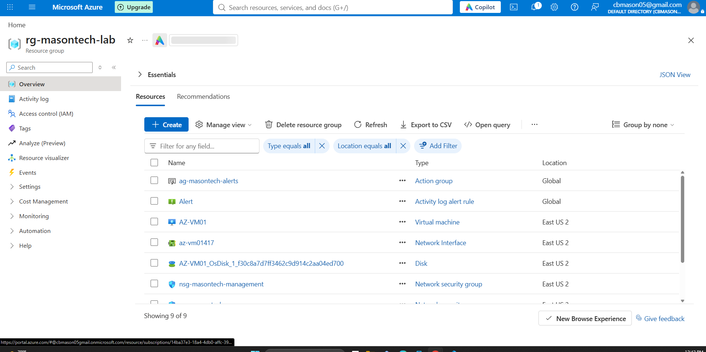
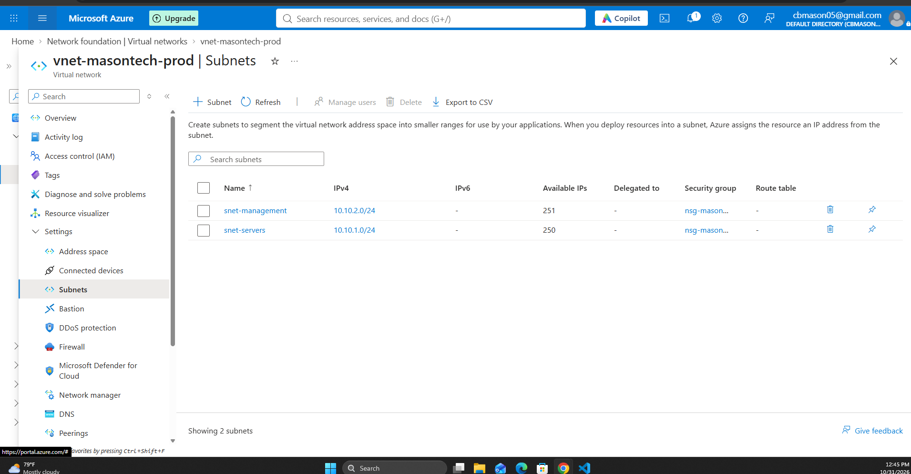
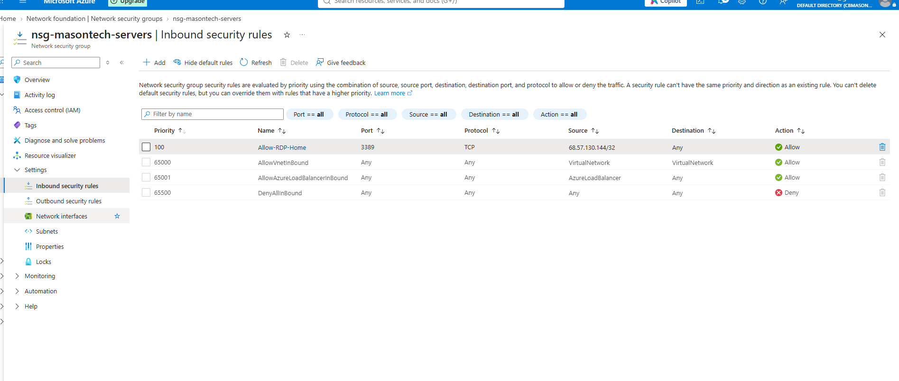
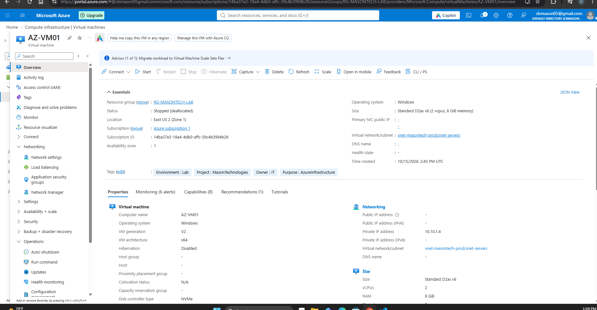
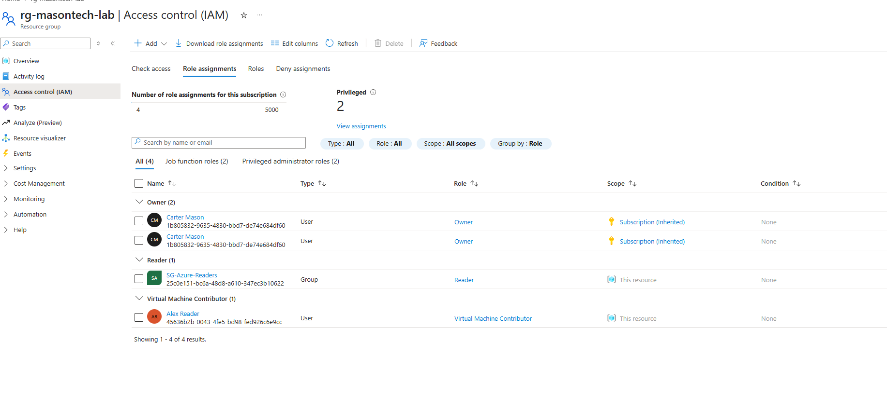
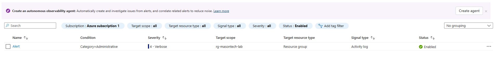

# Phase 2 — Azure Cloud Infrastructure

## Overview

Extended the Mason Technologies enterprise infrastructure lab into Microsoft Azure by deploying cloud resources, configuring network security, implementing role-based access control, and establishing infrastructure monitoring.

## 1. Azure Resource Organization

- Resource Group: rg-masontech-lab
- Region: East US 2
- Environment: Lab

## 2. Virtual Networking

- Virtual Network: 10.10.0.0/16
- Server Subnet: 10.10.1.0/24
- Workstation Subnet: 10.10.2.0/24

Configured subnet segmentation to separate server and workstation resources.

## 3. Network Security

Configured Azure Network Security Groups (NSGs) to control inbound traffic.

- Server NSG: nsg-masontech-servers
- Associated with the server subnet
- Restricted RDP (TCP 3389) to an authorized home public IP address using a /32 CIDR prefix

## 4. Azure Virtual Machine

- VM Name: az-vm01
- Private IP: 10.10.1.14
- Subnet: snet-servers

Deployed a Windows virtual machine and successfully validated Remote Desktop connectivity.

Removed the public IP association when remote access was no longer required to reduce exposure.

## 5. Identity and Access Management

Created an Entra ID test user named Alex.

Assigned the Virtual Machine Contributor role at the resource group scope.

Validated:
- VM visibility for the assigned user
- Availability of VM management controls
- Restricted ability to assign Azure RBAC roles

Demonstrated role-based access control and least-privilege principles.

## 6. Monitoring and Alerting

Configured Azure Monitor to monitor administrative operations.

- Signal: Azure Activity Log
- Category: Administrative
- Severity: 4
- Action Group: Email notification

Verified the notification email address.

Generated an administrative event by adding a resource group tag and confirmed the event appeared in Azure Activity Log.

### Monitoring Validation

Successfully validated Azure Monitor alert delivery.

1. Configured an Activity Log alert for administrative operations.
2. Associated an Action Group with a verified email recipient.
3. Generated a successful administrative event by updating resource group tags.
4. Confirmed the event appeared in Azure Activity Log.
5. Verified that Azure Monitor delivered an email notification.
6. Restored the alert condition to monitor failed administrative operations.

Result: End-to-end Azure Monitor alerting successfully tested.

## 7. Key Skills Demonstrated

- Azure Resource Manager
- Azure Virtual Networks and Subnets
- Network Security Groups
- Azure Virtual Machines
- Microsoft Entra ID
- Azure RBAC
- Azure Monitor
- Azure Activity Logs
- Infrastructure Security

## Next Phasea

Phase 3 — Hybrid Cloud Integration

Plan to establish secure connectivity between the on-premises Active Directory environment and Azure infrastructure.

## 8. Infrastructure Screenshots

### Azure Resource Group

### Virtual Network and Subnets

### Network Security Group

### Azure Virtual Machine

### Role-Based Access Control

### Azure Monitor

